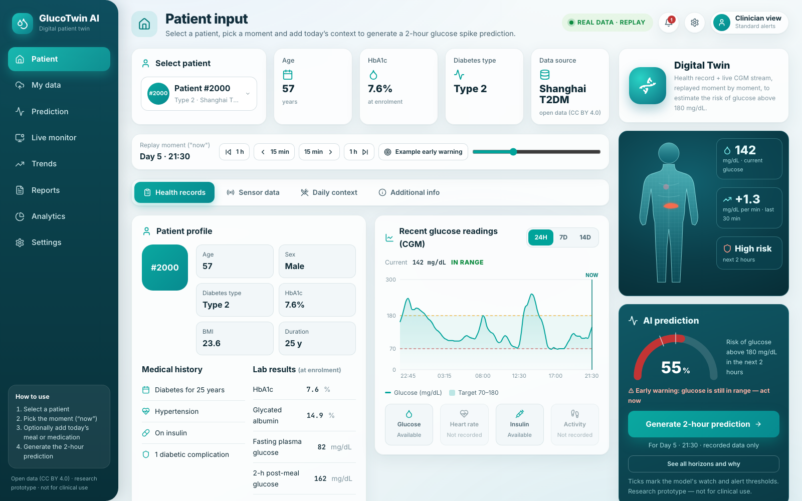
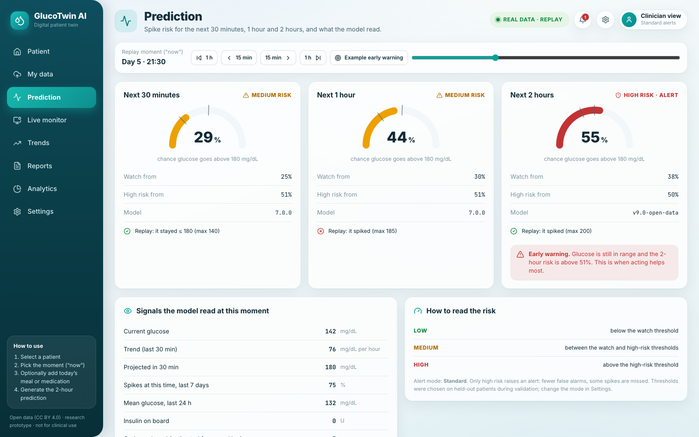
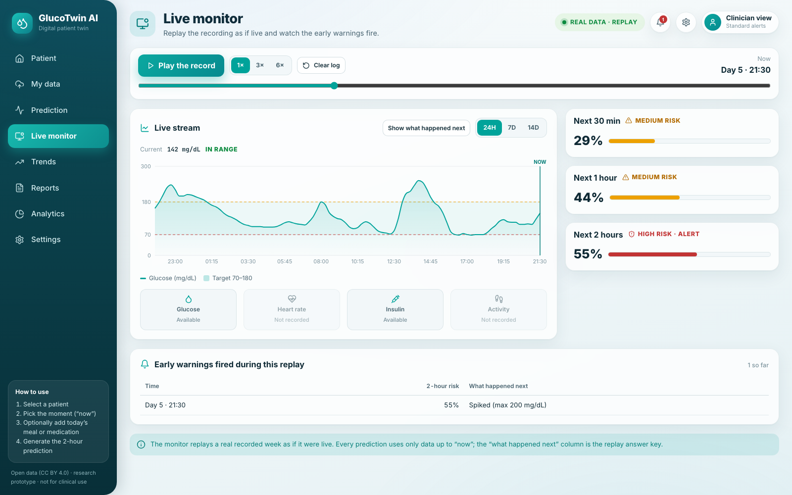
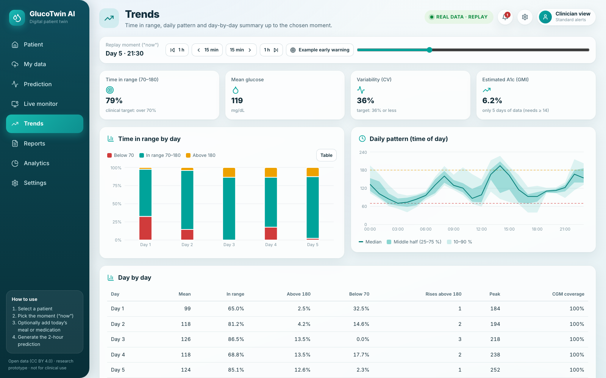
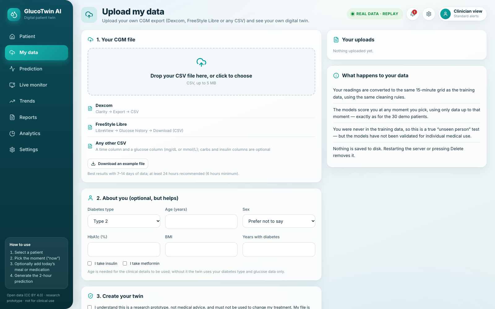
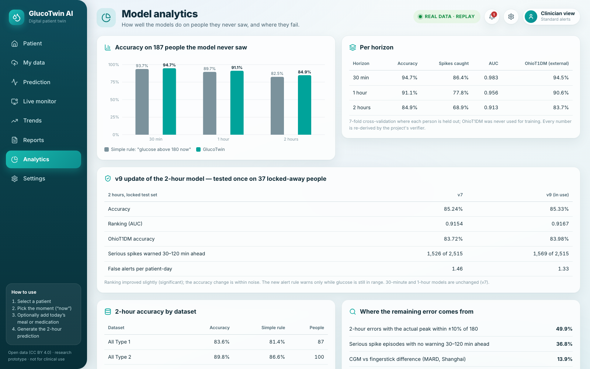
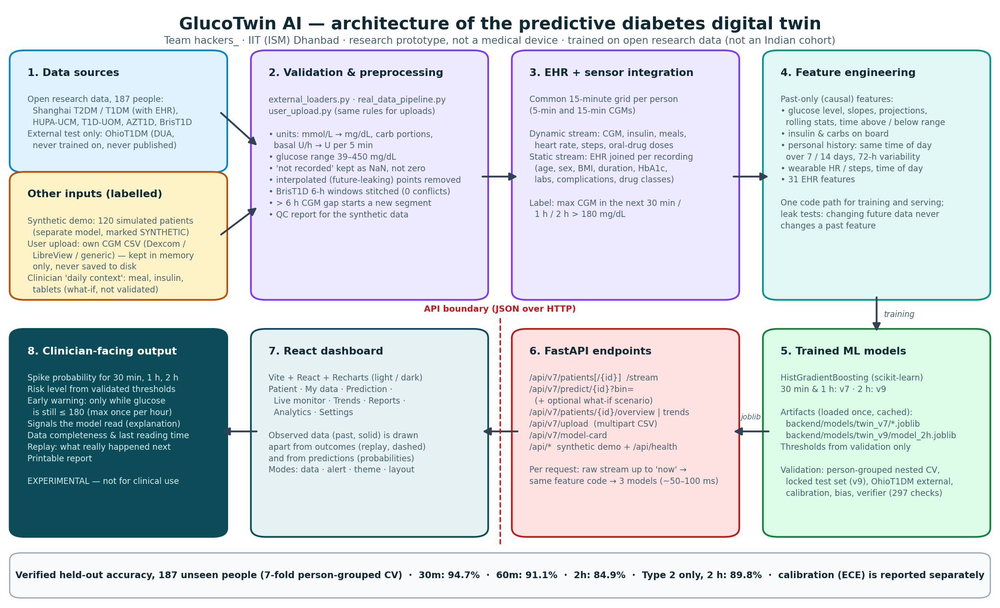

# GlucoTwin AI — Predictive Healthcare Digital Twin

**Predicts the probability that a person with diabetes will have glucose above 180 mg/dL in the next 30 minutes, 1 hour or 2 hours, by fusing their health record with their CGM and wearable stream.**

**Digital Twin Challenge 2026 · Happiest Health — Reimagining and Reforming Healthcare in India Summit**

> **Experimental research prototype.** Trained only on anonymised, openly licensed research datasets (none of them an Indian cohort), plus a clearly labelled synthetic demo. Not a medical device, not clinically validated, not for diagnosis or treatment decisions.

---

## Team

| | |
|---|---|
| **Team name** | hackers_ |
| **Institution** | IIT (ISM) Dhanbad |
| **Team leader** | Korra Santhosh |
| **Contact** | korrasanthosh2418@gmail.com |
| **Other members** | _Pending: to be added by the team_ |
| **Repository** | https://github.com/KorraSanthosh/happiness_ |
| **Presentation** | [`docs/GlucoTwin_Presentation.pdf`](docs/GlucoTwin_Presentation.pdf) (editable: [`.pptx`](docs/GlucoTwin_Presentation.pptx)) |
| **Architecture diagram** | [`docs/GlucoTwin_Architecture.pdf`](docs/GlucoTwin_Architecture.pdf) |
| **Licence** | Code: MIT ([`LICENSE`](LICENSE)) · Data: per-dataset licences (see [Data & licences](#data--licences)) |

### Demonstration video

**Demonstration video:** Pending recording by the team leader. The recording checklist and the place to insert the final link are in [`docs/VIDEO_PENDING.md`](docs/VIDEO_PENDING.md).

---

## Problem statement and healthcare use case

India has an estimated **101 million people living with diabetes** and 136 million with prediabetes (ICMR-INDIAB, *Lancet Diabetes & Endocrinology*, 2023). Repeated hyperglycaemia (glucose > 180 mg/dL) drives long-term complications, but today's care is **reactive**: a continuous glucose monitor (CGM) alarms *after* glucose is already high, and doctors usually see past readings rather than where a patient is heading.

**GlucoTwin** builds a virtual replica — a *digital twin* — of each patient by fusing:

- **Static / historical data (EHR):** demographics, diabetes type and duration, complications, comorbidities, medicines, laboratory results (HbA1c, fasting / post-meal glucose, C-peptide, lipids, kidney function).
- **Dynamic / real-time data:** CGM glucose, insulin (pump or injections), meals, and wearable heart rate / steps / energy.

The twin answers one question every 15 minutes, for three horizons:

> **"Will this patient's glucose go above 180 mg/dL in the next 30 minutes / 1 hour / 2 hours?"**

The output is a **probability** (not a predicted glucose value and not a diagnosis), turned into a low / medium / high risk level by thresholds chosen during validation. 30 minutes is for *act now*, 2 hours for *plan ahead*.

---

## Features and screenshots

All screenshots are from the running application (demo patient #2000, an anonymised open-data recording replayed as if live; no real hospital patient).

| | |
|---|---|
|  **Patient input** — patient selector, EHR and labs, CGM chart (24 h / 7 d / 14 d), data completeness, daily context (what-if), and the digital-twin panel with the live API prediction. |  **Prediction** — probabilities for 30 min, 1 h and 2 h with their validated thresholds, the 2-h early warning, the signals the model read, and the replay outcome. |
|  **Live monitor** — plays the recorded week forward and logs each early warning with what really happened next. |  **Trends** — time in range per day, daily glucose pattern, day-by-day table (data up to the chosen moment only). |
|  **My data** — upload your own Dexcom / LibreView / CSV export; kept in server memory only, never written to disk. |  **Analytics** — verified model performance, the v9 locked-test result and the error analysis. |

- **Observed vs predicted:** measured glucose is a solid line; what happened next (replay only) is dashed; predictions are probabilities in separate cards.
- **Modes (Settings):** data (open-data patients / synthetic demo), alert (standard / safety), theme (light / dark), layout (new / classic), and a custom background colour.
- **Reports:** a printable one-page summary for the chosen moment.
- **Loading and errors:** skeleton placeholders while loading; API errors (e.g. a sensor gap at the chosen moment) are shown as messages, never as made-up values.

---

## Results (people the model has never seen)

7-fold, **person-grouped, nested** cross-validation over **187 people** (87 Type 1, 100 Type 2) from 6 open datasets — about 530,000 prediction moments per horizon. Thresholds are chosen inside the training folds only.

| Horizon | Accuracy (95 % CI) | ROC-AUC | Spikes caught (recall) | Precision | Simple rule\* | **OhioT1DM external test** |
|---|---|---|---|---|---|---|
| **30 min** | **94.7 %** (94.3–95.1) | 0.983 | 86.4 % | 92.7 % | 93.7 % | **94.5 %** (AUC 0.986) |
| **60 min** | **91.1 %** (90.5–91.8) | 0.956 | 77.8 % | 91.4 % | 89.7 % | **90.6 %** (AUC 0.963) |
| **2 hours** | **84.9 %** (84.0–85.8) | 0.913 | 68.9 % | 88.2 % | 82.5 % | **83.7 %** (AUC 0.912) |

\* *Simple rule = "predict a spike if glucose is already above 180". It is the honest baseline: much of the accuracy at short horizons comes from it, and the model's added value grows with the horizon (+1.1 → +2.4 points accuracy, far better ranking).*

- **Safety mode** (lower alert threshold, also chosen inside training folds) catches **92.3 % / 85.3 % / 76.7 %** of spikes at 30 min / 1 h / 2 h, for 93.5 % / 89.8 % / 84.2 % accuracy.
- Recall and precision use the same per-fold threshold as accuracy (accuracy mode, median 0.51); every number in this section is re-derived from the held-out predictions by `backend/app/verify_results.py`.
- **Type 2 diabetes** (100 Shanghai patients, most relevant to India): **96.4 % / 93.8 % / 89.8 %** accuracy. At 2 h, Type 2 recall is 73.3 % and ROC-AUC 0.951; accuracy is 94.4 % where the actual peak was clearly away from 180 and 71.1 % where it was within ±10 % of 180 (this split uses the real outcome, so it explains errors and cannot be selected in advance).
- **External validation:** OhioT1DM was *never* used for training; performance there matches cross-validation, so the model generalises to a new hospital, device and population.
- **Over-fitting:** train-vs-test accuracy gap 0.3 / 0.5 / 1.0 points. **Fairness** (2 h; Shanghai patients, who have clinical records): accuracy women 90.0 % vs men 89.5 %; age groups 89.4–92.5 %; predicted vs observed spike rate within 1 point for every sex, age and BMI group. **Calibration** on held-out people: ECE 0.2–0.4 % (`docs/model_investigation.md`).

### What drives the predictions, and what we learned honestly

| Question | Answer from the data |
|---|---|
| Does fusing EHR + CGM beat CGM alone? | The EHR alone carries signal (AUC 0.65 on its own), but once the twin has the CGM stream it adds no measurable accuracy (89.7 % vs 89.8 %, n.s.): long-term control (HbA1c) is already visible in the glucose trace. In a patient's first 24 h, when the twin has little history, the EHR gives +0.2 points (88.4 % vs 88.2 %, not statistically significant). The fusion is built in so that richer records (e.g. ABDM-linked labs, prescriptions) can be added. |
| More data or more features? | In the earlier 87-person study (v6), the learning curve flattens after ~20 patients and extra feature families (activity, personal history) change accuracy by < 0.5 points. |
| Would perfect meal logs help? | In a v6 "what-if" test (81 people), telling the model future meals added only +0.2 points. In v7, where meals are logged, 37.1 % of missed spike moments had a meal logged *after* the prediction time (vs 22.1 % of spikes caught). |
| Most important signals (2 h) | distance to 180 mg/dL, current glucose, **spikes at this time of day in the past week** (the twin's personal memory), 15-min change, 30-min projection, time of day. |

### Where the remaining error comes from (verified, see [`docs/model_investigation.md`](docs/model_investigation.md))

- **49.9 % of 2-h errors** happen where the actual peak was within ±10 % of 180 mg/dL (accuracy 90.2 % on clear outcomes vs 66.8 % near 180, all 187 people). In the Shanghai data, CGM and fingerstick readings differ by a median of 11.0 % (MARD 13.9 %, 4,010 pairs from 98 people).
- **Serious spikes** (peak ≥ 250 mg/dL or ≥ 3 consecutive 15-min bins above 180): **36.8 %** of 9,503 distinct episodes got no warning 30–120 min ahead.

### v9: data-driven improvement round (tested once, on people locked away beforehand)

**Protocol.** Before any change, the 187 open-data people were split once into **DEV (150)** and a locked **TEST (37)** set (seed 2026, stratified by dataset). Every choice used DEV only, through 5-fold person-grouped cross-validation with inner-fold thresholds: which feature groups to keep, the thresholds, and the alert policy. The selected model and the baseline (v7 configuration retrained on DEV) were then scored **once** on TEST, on OhioT1DM and on a chronological holdout (the second half of each TEST person's record). Promotion rules were written down before TEST was scored. The spike label and the serious-episode definition were not changed.

**What the v7 errors had in common** (`models/combined_v9/error_analysis.json`):
- **Spikes far ahead:** 8 % of spikes starting 15–30 min ahead were missed, vs 87 % of those starting 105–120 min ahead.
- **Meals after the prediction:** 44 % of spikes were missed when a meal was logged *after* the prediction time, vs 28 % otherwise.
- **A few people:** the worst 10 % of people account for 44 % of missed moments.
- **Peaks just under 180:** 71 % of false alerts had a peak of 162–180 mg/dL.
- **Already high:** 26 % of false alerts fired while glucose was already above 180.
- **Little effect:** sensor gaps and step counts barely changed the miss rate (31–34 % across their strata), so no feature was built on them.

**Three feature groups were tested, one hypothesis each**, all past-only and covered by the leakage test:
- **C1, longer personal history:** the 14-day same-time spike rate, hours since the last high, and the 72-h share above 180.
- **C2, recorded meals and tablets:** Shanghai meal-log carbs estimated from the free text, plus oral-drug doses.
- **C3, multi-window dynamics:** the 2-h slope, the largest 1-h rise, hours to 180 at the current trend, and the 72-h CV.

| On DEV (150 people, 383,607 moments) | Accuracy | ROC-AUC | Accuracy gain vs base (95 % person CI) |
|---|---|---|---|
| Base (v7 inputs) | 84.66 % | 0.911 | — |
| + C1 personal history | 84.76 % | 0.913 | +0.10 (+0.01 to +0.18) |
| + C2 meals & tablets | 84.73 % | 0.912 | +0.07 (+0.02 to +0.13) |
| + C3 dynamics | 84.71 % | 0.912 | +0.04 (−0.02 to +0.11) |
| **All three (selected)** | **84.81 %** | **0.913** | **+0.15 (+0.09 to +0.22)** |

| On the locked TEST set (37 people, 147,200 moments), 2 h | v7 config | v9 features |
|---|---|---|
| Accuracy (95 % person CI) | 85.24 % (82.9–86.9) | 85.33 % (83.0–87.0) |
| Accuracy difference | — | +0.09 points (−0.05 to +0.25), not significant |
| ROC-AUC | 0.9154 | 0.9167: +0.0013 (+0.0004 to +0.0021) |
| Recall / precision / specificity | 68.8 / 88.2 / 94.7 % | 70.1 / 87.2 / 94.1 % |
| F1 / PR-AUC / Brier / ECE | 0.773 / 0.893 / 0.105 / 0.85 % | 0.777 / 0.895 / 0.104 / 0.66 % |
| Type 2 accuracy | 90.41 % | 90.37 % |
| OhioT1DM external (12 people) | 83.72 % (AUC 0.9125) | 83.98 % (AUC 0.9140) |
| Chronological holdout | 85.44 % (AUC 0.9177) | 85.45 % (AUC 0.9191) |

**The alert policy.** A warning matters only if it comes **while glucose is still in range**, so the v9 policy fires only while glucose ≤ 180, and at most once an hour. Its threshold (0.51) was chosen on DEV: catch the most serious episodes without more false alerts per patient-day than the v7 policy.

| TEST: 2,515 serious episodes, 1,533 patient-days | Serious episodes warned 30–120 min ahead | False alerts / patient-day | All alerts / day |
|---|---|---|---|
| v7 model, v7 policy | 1,526 (60.7 %, CI 54.0–68.1) | 1.46 | 8.6 |
| v7 model, v9 policy | 1,571 (62.5 %): **+1.8 points (+1.3 to +2.2)** | 1.34: **−0.13 (−0.21 to −0.001)** | 3.6 |
| **v9 model, v9 policy (served)** | 1,569 (62.4 %): +1.7 points (+0.1 to +3.9) | 1.33: −0.14 (−0.25 to +0.04) | 3.7 |

**What this means.**
- **Small model gain:** the new information gives a real but small improvement in ranking (AUC). Accuracy is unchanged within noise, so v9 is **not** an accuracy jump.
- **Fewer, earlier-useful alerts:** the clearer gain is in alerting. Warning only while glucose is still in range cuts alerts per day by more than half and warns of slightly more serious episodes.
- **Served now:** both passed the pre-registered rules, so the dashboard's 2-h model is v9 and shows an *early warning* flag. The 30-min and 1-h models stay v7, because v9 validated only the 2-h horizon. Delete `backend/models/twin_v9/` to roll back to v7.
- **Label sensitivity:** re-scoring the same TEST predictions with spike thresholds of 170, 190 or 198 mg/dL, or "two bins in a row above 180", gives 82.1–85.9 % accuracy. 49 % of errors have a peak within ±10 % of 180.

**Data search.** No openly licensed CGM dataset from **Indian** people with Type 2 diabetes was found that we could download and use, so none was added and the Chinese cohort remains the closest proxy.

Full numbers: [`models/combined_v9/`](models/combined_v9/): `stage_cv`, `stage_policy`, `stage_final`, `stage_labels`, `stage_report`. All are re-derived by `verify_results.py`.

Full numbers: [`models/combined_v7/stage_cv.json`](models/combined_v7/stage_cv.json), [`stage_ablation.json`](models/combined_v7/stage_ablation.json), [`stage_final.json`](models/combined_v7/stage_final.json), [`model_card.json`](models/combined_v7/model_card.json).

---

## Architecture



PDF: [`docs/GlucoTwin_Architecture.pdf`](docs/GlucoTwin_Architecture.pdf) · regenerate with `python3 docs/generate_architecture.py`.

1. **Data sources** — six open research datasets for training (see licences below); OhioT1DM only as a local external test; a separate synthetic demo; and optional user uploads (in memory only).
2. **Validation & preprocessing** (`backend/app/external_loaders.py`, `real_data_pipeline.py`, `user_upload.py`) — unit harmonisation (mmol/L, carbohydrate portions, basal U/h), glucose range 39–450 mg/dL, "not recorded" kept distinct from zero, BrisT1D's overlapping 6-hour windows stitched into one timeline (0 conflicts in 11.4 M values), HUPA-UCM's linear gap-filling removed (it leaked future readings), long-acting insulin spread over 24 h.
3. **EHR + sensor integration** — every person on one 15-minute grid (5- and 15-minute CGMs); the Shanghai clinical summary joined per recording.
4. **Feature engineering** — 80 past-only stream features (glucose dynamics, insulin- and carbs-on-board, wearable activity, personal 7-day / 24-hour history, time of day) + 31 EHR features → 111 features; the v9 2-hour model adds 12 history / trend features (123). One code path for training and serving; automated tests prove that changing *future* data never changes a *past* feature.
5. **Models** (`backend/app/real_data_v7.py`, `real_data_v9.py`) — HistGradientBoosting classifiers for 30 min, 60 min and 2 h, per-person training weights, thresholds chosen on validation data only. The served 2-h model is v9 with an early-warning policy; 30 min and 1 h are v7. Artifacts: `backend/models/twin_v7/*.joblib`, `backend/models/twin_v9/model_2h.joblib`, loaded once and cached.
6. **FastAPI** (`backend/app/main.py`, `twin_v7.py`) — for any moment, the API runs the *same* feature code on the raw stream up to that moment plus the EHR, then the three models (about 50–100 ms).
7. **React dashboard** (`frontend/src/studio/`) — the pages above; the classic dashboard (`frontend/src/components/`) remains available as a layout mode.
8. **Clinician-facing output** — probabilities, risk level, early warning, the signals read, data completeness and the replay outcome. Demo patients were **excluded from the demo models' training**, so every prediction shown is for an unseen person.

---

## Technical stack

| Layer | Technology |
|---|---|
| Machine learning | Python 3.9, scikit-learn 1.5 (HistGradientBoostingClassifier), pandas, NumPy |
| Validation | Person-grouped nested CV, locked test set, patient-cluster bootstrap CIs, automated verifier |
| Backend API | FastAPI 0.111, Pydantic v2, Uvicorn, python-multipart (uploads) |
| Frontend | React 18, Vite 6, Recharts, lucide-react |
| Data formats | Parquet, JSON, CSV, Excel (openpyxl / xlrd) |
| Tests | pytest — 110 tests (leakage, labels, loaders, uploads, API, result consistency) |
| Docs | matplotlib (architecture), pptxgenjs + Keynote (deck), headless Chromium (script PDF) |

---

## API

Interactive documentation: `http://localhost:8000/docs` (Swagger) once the backend runs.

| Method & path | Purpose |
|---|---|
| `GET /api/health` | Health check |
| `GET /api/v7/patients` | The 30 open-data demo patients (and any uploads) |
| `GET /api/v7/patients/{id}` | Patient detail: EHR summary, labs, record length, default moment |
| `GET /api/v7/patients/{id}/stream?bin=&hours=&future=` | Glucose / insulin / carbs / HR / steps around a moment (15-min bins); `future=true` adds the replay |
| `POST /api/v7/predict/{id}?bin=` | Probabilities for 30 min / 1 h / 2 h, levels, thresholds, early warning, signals, replay outcome. Optional JSON body `{"carbs_g", "insulin_u", "oral_tablets"}` adds a what-if scenario |
| `GET /api/v7/patients/{id}/overview?bin=` | Data completeness and last-24-h glucose summary (past data only) |
| `GET /api/v7/patients/{id}/trends?bin=` | Per-day time in range and hourly profile (past data only) |
| `POST /api/v7/upload` | Multipart CSV + optional health form (`consent=true` required) → creates an in-memory twin |
| `DELETE /api/v7/upload/{id}` | Removes an uploaded twin |
| `GET /api/v7/upload/example.csv` | Example file (3 days of a CC BY demo patient, made-up dates) |
| `GET /api/v7/model-card` | Verified summary, v9 block, error analysis, model metadata |
| `GET /api/patients`, `GET /api/patients/{id}/twin`, `POST /api/predict/{id}`, `GET /api/model-card`, `GET /api/stats` | Synthetic demo (simulated patients, separate model) |

Example:

```bash
curl -X POST "http://localhost:8000/api/v7/predict/sh_t2_2000?bin=414"
curl -X POST "http://localhost:8000/api/v7/predict/sh_t2_2000?bin=414" -H "Content-Type: application/json" -d '{"carbs_g": 60}'
```

Errors are explicit: `404` for an unknown patient, `422` for an invalid moment, a sensor gap at the chosen moment, or an unusable upload.

---

## Data & licences

The challenge requires anonymised, open-source or synthetic data. Five of the six training datasets are **CC BY 4.0**. BrisT1D's dataset is also published under CC BY 4.0, but we used the copy distributed with a Kaggle competition, whose rules we have not separately verified; no BrisT1D records are in this repository. Full provenance: [`docs/DATA_SOURCES.md`](docs/DATA_SOURCES.md).

| Dataset | People | Type | Signals | Source |
|---|---|---|---|---|
| ShanghaiT2DM | 100 | T2D | CGM (15 min), insulin, **clinical EHR** | Zhao et al., *Sci Data* 2023 · [figshare 10.6084/m9.figshare.20444397](https://doi.org/10.6084/m9.figshare.20444397) |
| ShanghaiT1DM | 12 | T1D | CGM, insulin, **clinical EHR** | same as above |
| HUPA-UCM | 24 | T1D | CGM, insulin, carbs, Fitbit HR/steps/kcal | Hidalgo et al., *Data in Brief* 2024 · [10.17632/3hbcscwz44.1](https://doi.org/10.17632/3hbcscwz44.1) |
| AZT1D | 25 | T1D | CGM, pump basal/bolus, carbs | Mayo Clinic Arizona 2025 · [10.17632/gk9m674wcx.1](https://doi.org/10.17632/gk9m674wcx.1) |
| T1D-UOM | 17 | T1D | CGM, insulin, carbs, HR/steps | University of Manchester 2025 · [10.5281/zenodo.15806142](https://doi.org/10.5281/zenodo.15806142) |
| BrisT1D | 9 | T1D | CGM, insulin, carbs, HR/steps | University of Bristol (Kaggle competition release) |
| OhioT1DM | 12 | T1D | CGM, insulin, carbs, HR | Data-use agreement — **external test only, never trained on, not in this repository** |

- **Not committed:** raw datasets, `external_data/`, zips, and every experiment frame / prediction file / full model under `models/combined_*/` (they contain dataset-derived rows, including OhioT1DM). `backend/scripts/download_open_data.py` downloads the open datasets; BrisT1D needs a Kaggle account; OhioT1DM requires signing its data-use agreement.
- **Committed:** the dashboard demo pack `backend/data/twin_v7/` (30 people from CC BY 4.0 sources only, see its `ATTRIBUTION.md`), the demo models trained without those 30 people, result summaries (JSON), and the synthetic demo data.
- **Not an Indian cohort:** no openly licensed Indian Type 2 CGM dataset was found; the Chinese Shanghai T2DM cohort is the closest open proxy.

### Synthetic demo data

The original demo (120 simulated patients with simulated EHR and CGM, `backend/data/patients.json` + `readings.parquet`) is labelled **Synthetic demo** in the app and uses its own model (`backend/models/glucotwin_model.pkl`). Regenerate it with:

```bash
cd backend
python -m app.data_generator --force   # 120 patients x 7 days, seed 42 -> data/
python -m app.train_model              # synthetic model + data_quality_report.json -> models/
```

---

## How to run

**Prerequisites:** Python 3.9+, Node.js 18+ (tested with Python 3.9 and Node 26 on macOS).

```bash
# 1. backend
cd backend
pip install -r requirements.txt
python -m uvicorn app.main:app --port 8000          # API docs: http://localhost:8000/docs

# 2. frontend (new terminal)
cd frontend
npm install
npm run dev                                          # open http://localhost:5173
```

No environment variables or secrets are needed (see [`.env.example`](.env.example)). The dashboard uses the committed demo pack and models in `backend/data/twin_v7`, `backend/models/twin_v7` and, for the 2-hour horizon, `backend/models/twin_v9`. Production build: `cd frontend && npm run build`.

### Tests and verification

```bash
cd backend
python -m pytest tests/ -q                                  # 110 tests
python3 -I scripts/run_isolated.py -m:app.verify_results    # re-derives every published number (297 checks)
```

`verify_results.py` recomputes the metrics from the held-out predictions and exits non-zero on any mismatch. Those prediction files are not in the repository (they contain dataset-derived rows), so on a fresh clone the full verifier needs the research pipeline below; `tests/test_results_consistency.py` still checks that the README, model cards and dashboard summary agree with the committed result JSON.

### Model training and evaluation (research pipeline, ~1–2 h)

```bash
cd backend
python scripts/download_open_data.py                 # open datasets -> ../external_data/
# BrisT1D: download train.csv from Kaggle into ../brist1d_raw/ (Kaggle account needed)
# OhioT1DM (optional external test): place under ../ohiot1dm_raw/ after signing its data-use agreement
python -m app.real_data_v7 --stage all --rebuild     # CV, ablation, final models -> ../models/combined_v7/
python -m app.build_twin_demo                        # dashboard demo pack + demo models
python -m app.error_analysis_v9                      # v9: error analysis of the frozen v7 baseline
python -m app.real_data_v9 --stage all               # v9: DEV/TEST split, CV, policy, TEST, labels (~45 min)
python -m app.build_twin_v9                          # v9: served 2-h model + demo extras
python ../docs/generate_architecture.py              # architecture diagram
```

Downloaded datasets are untrusted input: the loaders only read them with pandas, never execute files from them (`scripts/run_isolated.py` runs modules in isolated mode).

---

## Repository structure

```
backend/
  app/
    main.py                 FastAPI app (synthetic demo /api/* + includes /api/v7)
    twin_v7.py              /api/v7: live twin inference, what-if, overview, trends, uploads
    user_upload.py          CGM CSV parser (Dexcom / LibreView / generic) -> training grid
    real_data_pipeline.py   15-min grid, past-only features, labels (30 min / 1 h / 2 h)
    external_loaders.py     HUPA-UCM, T1D-UOM, AZT1D, Shanghai loaders + EHR parser
    real_data_v7.py         submission model: nested CV, fusion ablation, external test, bias
    real_data_v9.py         v9: locked DEV/TEST split, feature-group tests, alert policy
    build_twin_demo.py      dashboard demo pack + demo models (demo patients excluded)
    build_twin_v9.py        served v9 2-h model + demo extras
    verify_results.py       re-derives every published number
    data_generator.py, train_model.py, predictor.py, features.py   synthetic demo pipeline
  data/                     synthetic demo data + twin_v7 demo pack (CC BY 4.0)
  models/                   synthetic model, twin_v7 / twin_v9 demo models (joblib)
  scripts/                  open-data download, isolated launcher
  tests/                    110 pytest tests
frontend/src/
  studio/                   new dashboard (pages, charts, state, styles)
  components/               classic dashboard (layout mode "classic")
  services/api.js           API client
docs/
  GlucoTwin_Architecture.pdf, GlucoTwin_Presentation.pdf|pptx
  model_investigation.md, DATA_SOURCES.md, VIDEO_PENDING.md, screenshots/
models/                     result summaries (JSON): combined_v5|v6|v7|v9|t2d, investigation/, baseline_v7/
```

Earlier iterations (v5: Ohio + BrisT1D, 21 patients; v6: 87 patients; v8: Type 2 study in `models/combined_t2d/`) are kept for transparency. `CLAUDE.md` records the full development history; `DEMO_SCRIPT.md` and `MODEL_COMPARISON.md` describe only the original synthetic demo.

---

## Model card

- **Intended use:** research and demonstration of a diabetes digital twin; not for clinical use.
- **Model:** HistGradientBoostingClassifier per horizon (30 min, 1 h: v7; 2 h: v9), probabilities with validated thresholds (accuracy mode / safety mode) and a 2-h early-warning rule.
- **Training data:** 187 people from six open research datasets (87 Type 1, 100 Type 2); OhioT1DM external test only.
- **Evaluation:** see Results above; machine-readable cards in [`models/combined_v7/model_card.json`](models/combined_v7/model_card.json) and [`models/combined_v9/model_card.json`](models/combined_v9/model_card.json); full error analysis in [`docs/model_investigation.md`](docs/model_investigation.md).
- **Known failure modes:** spikes starting late in the window, spikes after meals eaten after the prediction, peaks close to 180 mg/dL, a minority of people with much higher miss rates.

---

## Limitations, ethics and clinical safety

- Research prototype, **not clinically validated**, not a medical device; it has not been shown to reduce complications in real patients.
- The EHR is real only for the Shanghai cohort; other datasets contribute diabetes type only. **No Indian-population dataset was openly available** — the Chinese T2D cohort is the closest proxy, and Indian clinical validation is the necessary next step.
- Spikes without a recorded cause (stress, illness, unlogged food) remain unpredictable; recall at 2 h is ~70 % (77 % in safety mode), and about 38 % of serious episodes still get no warning 30–120 min ahead (TEST, served v9 model and policy).
- About half of the remaining 2-h errors are moments whose peak lands within ±10 % of 180 mg/dL, where CGM and fingerstick readings themselves disagree by ~11 %.
- Accuracy, recall and calibration are different measures; a low calibration error (ECE) is not accuracy.
- What-if (daily context) answers and predictions on uploaded data are not separately validated.

## Privacy and security

- Only anonymised open research data and synthetic data are used; no real patient identities, no secrets or API keys in the repository.
- Uploaded files are processed by the local backend, kept only in memory (max 20 uploads), never written to disk, and removed on delete or restart; an explicit consent checkbox is required.
- Restricted data (OhioT1DM) and dataset-derived prediction files are excluded by `.gitignore`.
- A real deployment in India would need DPDP-Act-compliant consent, authentication, encrypted transport and storage, audit logs, and clinician-in-the-loop alerting.

## Licence

Code is released under the MIT licence ([`LICENSE`](LICENSE)). Datasets keep their own licences (CC BY 4.0 for five training datasets; BrisT1D as noted above — attribution in [`docs/DATA_SOURCES.md`](docs/DATA_SOURCES.md) and `backend/data/twin_v7/ATTRIBUTION.md`); OhioT1DM is not redistributed.

## Citations

- ICMR-INDIAB: Anjana RM et al., *Lancet Diabetes Endocrinol* 2023;11:474-489.
- Zhao Q et al., *Chinese diabetes datasets for data-driven machine learning*, Sci Data 10, 35 (2023).
- Hidalgo JI et al., *HUPA-UCM diabetes dataset*, Data in Brief 55 (2024) 110559.
- AZT1D: *AZT1D: A Real-World Dataset for Type 1 Diabetes*, arXiv:2506.14789 (2025).
- T1D-UOM: *A Longitudinal Multimodal Dataset of Type 1 Diabetes*, University of Manchester, Zenodo (2025).
- BrisT1D: University of Bristol, *BrisT1D Dataset*, arXiv:2507.17757 (2025).
- Marling C, Bunescu R, *The OhioT1DM Dataset for Blood Glucose Level Prediction* (2020).
